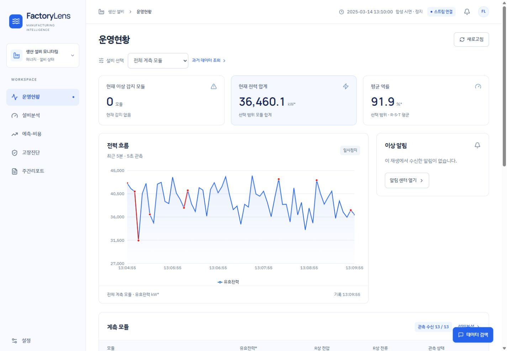
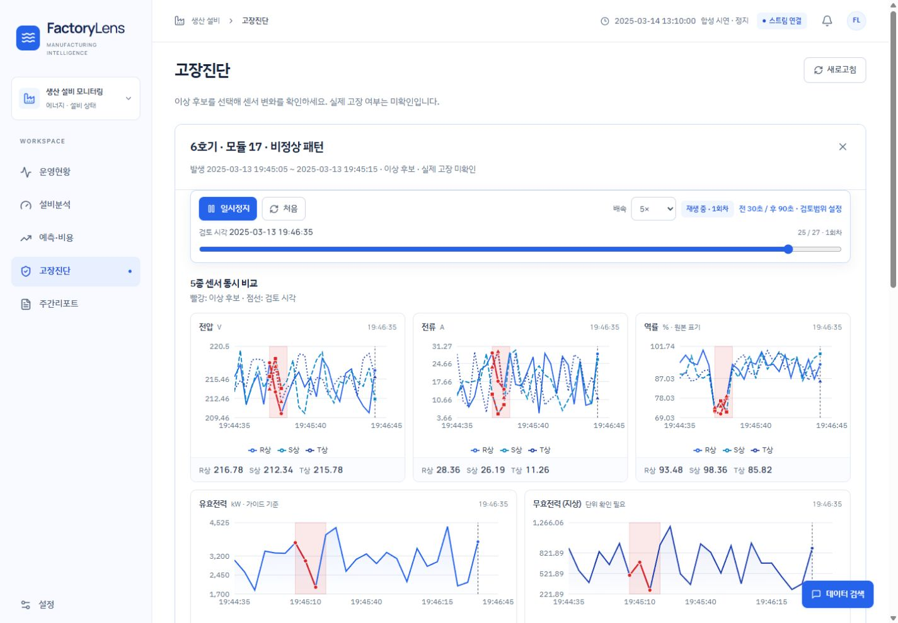
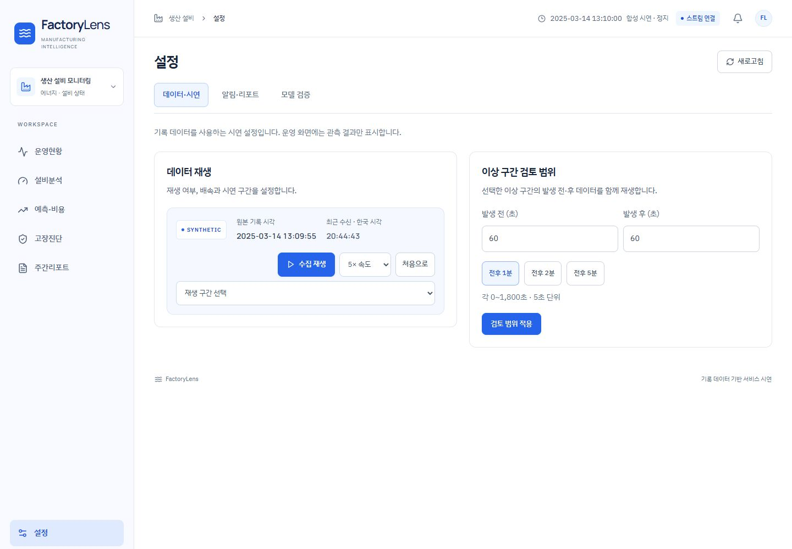

# FactoryLens

**Manufacturing-AI-2026-Team4 · 2026 제조 산업 특화 산업형 AI 교육 4조**

FactoryLens는 생산 업체의 설비·에너지 데이터를 운영자가 확인하고, 이상 후보의 근거를 검토하며, 전력 전망과 주간 현황을 살펴보는 **SI 제안용 운영 데모**입니다. 기록 데이터 분석부터 예측·이상 탐지 실험, 웹 서비스와 사용자 화면까지 연결했습니다.

이 데모의 스트리밍은 **과거 5초 기록을 서버에서 순서대로 재생하는 방식**입니다. 화면의 ‘현재’는 선택한 기록 재생 시각을 뜻하며, 실제 공장의 현재 가동 상태나 실시간 IoT 연결을 의미하지 않습니다. 원본 관측 재생과 원본 기반 합성 시나리오는 화면에서 구분합니다.



## 주요 기능

| 화면 | 제공 기능 |
| --- | --- |
| 운영현황 | 현재 이상 감지 모듈·유효전력·평균 역률의 3개 핵심 지표, 최근 5분 전력 흐름, 이번 재생 세션의 감지 알림과 관측 상태 |
| 설비분석 | 모듈별 실시간 관측과 과거 기간 조회, 전압·전류·역률·전력 신호, 시간·일·주·월 집계와 부분 집계 범위 표시 |
| 고장진단 | 미확인 이상 후보 목록과 탐지 근거, 전압 R/S/T·전류 R/S/T·역률 R/S/T·유효전력·무효전력의 **5개 그래프 동시 비교** |
| 예측·비용 | 원점 이전 완료 관측만 사용하는 향후 24시간 전력 전망, 프로젝트 계수에 따른 비용·탄소 추정 |
| 주간리포트 | 선택 대상의 최근 저장 리포트, 보관함, 명시한 기준의 신규 리포트 생성과 선택적 자동 생성 설정 |
| 하단 데이터 질문 | 현재 조회·진단 검토 범위의 출처·모듈·기간을 표시하고 로컬 통계를 조회하는 질문창 |
| 설정 | **데이터·시연 / 알림·리포트 / 모델 검증** 3개 탭으로 재생·연동·연구 평가 기능 분리 |

고장진단의 구간 반복 재생은 전역 수집 재생과 독립된 읽기 전용 플레이어입니다. 5개 그래프가 같은 시각·범위·커서를 공유하고, 정지·탐색·배속·반복을 함께 적용합니다. 기본 전후 60초 검토 범위는 설정에서 조절할 수 있으며, 이 검토가 수신 로그·알람·Slack 메시지를 다시 발행하지는 않습니다.





## 기술 구성

| 영역 | 기술 |
| --- | --- |
| 프런트엔드 | React 19, Vite, Recharts, Lucide |
| 서버·스트리밍 | Python, FastAPI, Uvicorn, Server-Sent Events(SSE) |
| 데이터·상태 저장 | pandas, NumPy, SQLite |
| 예측·이상 탐지 | PyTorch, scikit-learn, XGBoost, statsmodels, 공식 모델 코어·체크포인트 |
| 선택적 외부 연동 | OpenAI GPT-5 mini Responses API, Slack Incoming Webhook |

GPT·Slack 연동은 서버 측 환경변수와 명시적 활성화·승인이 필요한 선택 기능입니다. `.env.example`는 빈 설정 예시이며 `.env`를 자동으로 읽지 않습니다. GPT 모델은 `gpt-5-mini`로 고정되어 있습니다. 키가 없거나 전송 승인이 없으면 외부 연동 없이 로컬 통계와 기존 분석 결과를 사용합니다. 이 README는 실제 GPT 응답이나 Slack 전송의 성공을 보장하지 않습니다.

## 데이터와 해석 범위

| 항목 | 내용 |
| --- | --- |
| 학습 원본 | `traing-dataset/rtu_data_full.csv` — 폴더명의 `traing` 표기를 그대로 사용 |
| 규모 | 33,696,013행, 19필드, 13개 계측 모듈, 모듈별 5초 관측 |
| 기록 기간 | 2024-12-01 00:00:00 ~ 2025-04-30 00:00:00 |
| 완전 시간 집계 | 3,600시간(150일); 마지막 4월 30일 00시 표본은 완전한 하루·시간이 아님 |
| 최종 예측 평가 정답 | `may-dataset/rtu_ground_truth_may.csv` — 2025-05-10 00시 ~ 05-31 00시의 505개 시간값 |
| 시간 기준 | 원자료 `localtime`; Unix `timestamp`의 오프셋·중복 문제 때문에 두 값을 같은 시각으로 단정하지 않음 |

전력량은 가이드의 유효전력 kW 표기에 따라 `유효전력 × 5 / 3600`을 합산한 **잠정 kWh**입니다. 13개 계측 모듈의 상·하위 계층과 계측 배율이 확정되지 않아, 모듈 합계에는 중복 계측이 포함될 수 있습니다. 이를 인증된 공장 전체 소비량으로 해석하지 않습니다.

비용 180원/kWh, 탄소 0.424kgCO₂/kWh는 프로젝트 계산 계수이며 실제 계약 요금·배출계수를 대체하지 않습니다. 평균 역률은 상별·모듈별 산술 평균입니다. 부분 주·월은 관측한 기간만 표시하며 완전 기간과 구분합니다.

## 이상 후보 탐지와 검증

여섯 형태의 맥락 규칙과 Autoencoder(AE), Isolation Forest(IF)를 비교하고, 합성 변형 유형 분류기를 별도로 학습했습니다.

- 검사 형태: 부하 불균형, 무효전력 급증, 역률 급감, 비정상 패턴, 야간 이상가동, 전류만 증가.
- 학습 기준은 2024년 12월, 임계값·모델 선택은 2025년 1월, 이후 2~4월은 보정 이후 표본 비교 구간입니다.
- 규칙과 AE는 원본 33,696,013행을 전수 검사했습니다. IF·분류기는 시간층화 187,200행 표본과 저장 후보의 정확한 원본 최대점에서 계산했습니다.
- 합성 분류기는 원본 기반의 여섯 변환과 미변형 참조를 구분합니다. 합성 시험 macro F1은 **0.9794**이며, 이는 **실제 고장 진단 정확도가 아닙니다**.
- 3시점 이상 연속 후보는 AE 중심 3개와 약한 역률 규칙 후보 1개를 검토 자료로 제공합니다. 모든 유형을 발견했다는 뜻이 아니며, 저장된 검토 후보 180개도 실제 고장 정답 180개를 뜻하지 않습니다.

실제 고장 종류·삽입 위치·고장 시각의 정답 라벨은 제공되지 않았습니다. 따라서 원본 경보는 **미확인 이상 후보**이고, 합성 유형 유사도는 실제 고장 확률이 아닙니다. 감지되지 않았다는 사실만으로 정상 운전을 확정하지 않습니다. 상세 수식·분할·제한은 [진단 분석 안내](demo_platform/analytics/diagnosis/README.md)에 정리했습니다.

## 예측 연구와 운영 전망의 구분

**운영 화면의 24시간 전망**은 해당 재생 원점 이전에 완료된 시간 관측으로 계산하는 과거 평균 기준선입니다. 개별 모듈은 그 모듈의 과거값으로 독립 계산합니다. 4월 말까지 학습한 모델을 12월·3월 재생에 적용하거나, 전체 합계를 나누어 개별 모듈 모델처럼 표시하지 않습니다. 관측이 부족하면 대기·cold-start 상태로 표시합니다.

**모델 검증 화면**은 별도로 동결한 연구 실험입니다. ARIMA, Ridge, XGBoost, PatchTST, iTransformer, Chronos-2 및 기준선의 총 196개 설정을 비교했습니다. PatchTST·iTransformer는 재학습했고, Chronos-2는 공식 120M 체크포인트의 고정 가중치를 사용했습니다. 특정 연도의 최고 성능 모델이라는 주장은 하지 않습니다.

선택 기준은 2025-02-15·02-22·02-25 각 원점의 공통 745시간 경로 중 **마지막 505시간 MAE의 원점별 평균**입니다. 검증 구간끼리는 겹치므로 1,515개 평가값은 독립된 1,515시간을 뜻하지 않으며, 고유 시간은 745개입니다. 최신 검증 정답은 3월 28일 00시로, 3월 29일 내부 시험 원점보다 과거입니다. 스케일러·정규화·조기 종료는 각 학습 접두 구간에서만 결정했습니다.

| 모델 | 검증 MAE ↓ | 최종 5월 MAE ↓ | 최종 5월 R² |
| --- | ---: | ---: | ---: |
| 기준선(전체 과거 절사평균) | 76.2370 | 89.0083 | -0.3893 |
| ARIMA | 76.2371 | 89.0314 | -0.3899 |
| Ridge | 76.2372 | 89.0322 | -0.3899 |
| XGBoost | 76.2525 | 89.1201 | -0.3924 |
| PatchTST | 76.2732 | 89.0017 | -0.3927 |
| **iTransformer — 검증 선택** | **76.2075** | **89.1146** | **-0.3933** |
| Chronos-2 | 76.2262 | 88.8591 | -0.3851 |

MAE 단위는 잠정 kWh이며, 위 기준선은 연구용 설정으로 운영 API의 단순 과거 평균과 구분합니다. iTransformer의 검증 개선은 기준선 대비 약 **0.039%**에 불과하며, 최종 5월에는 기준선보다 오차가 컸습니다. 모든 모델의 5월 R²가 음수여서 변동 예측력을 확보했다고 주장하지 않습니다. 5월의 사후 최저 MAE인 Chronos-2로 선택을 바꾸지 않았습니다.

고정 최종 예측은 4월 30일 원점의 745시간 경로이며, 정답이 있는 5월 10일~31일의 505시간만 평가했습니다. 앞 240시간의 정답을 보간하지 않았습니다. 모든 설정·선택 동결 이후 한 번 평가했고, 정답을 본 뒤 배율·편향·모델을 보정하지 않았습니다. 다만 이전 5월 EDA 이력이 있으므로 완전히 새로운 맹검 실험으로 설명하지 않습니다.

정규화·역변환 검사에서 단위 변환 오류는 발견되지 않았습니다. 실제 물리 단위의 불확실성은 별개이며, 정답과 예측을 같은 비율로 바꿔도 R²는 개선되지 않습니다. 낮은 MAPE도 큰 평균과 작은 변동에서 나타날 수 있습니다. 결과 원문은 [예측 결과](demo_platform/analytics/forecast/results.json), [정규화 감사](demo_platform/analytics/forecast/normalization_audit.json), [서빙 설명](demo_platform/analytics/forecast/README.txt)을 참고하세요.

## 저장소 구조

```text
Manufacturing-AI-2026-Team4/
├─ demo_platform/
│  ├─ frontend/             # React 화면, pnpm lockfile
│  ├─ backend/              # API, SSE, 원본 조회, 상태·연동 처리
│  ├─ analytics/
│  │  ├─ forecast/          # 예측 실험·저장 결과·서빙 코드
│  │  └─ diagnosis/         # 규칙·AE·IF·합성 분류·검토 후보
│  ├─ docs/                # 설계·API·구현 설명
│  ├─ tests/               # API·시점 가용성·범위·재생 검사
│  └─ launch.ps1           # 로컬 실행
├─ output/                 # 기존 연구와 같은 상대 경로의 필수 집계·분석 결과
├─ scripts/                # 제출 검사·데이터 준비 설명
├─ docs/screenshots/       # README 화면 이미지
├─ requirements.txt        # 제출용 Python 의존성
├─ traing-dataset/         # 사용자가 별도로 준비하는 원본 CSV(공개 제외)
└─ may-dataset/            # 사용자가 별도로 준비하는 평가 CSV(공개 제외)
```

`output/`과 `demo_platform/analytics/`의 상대 경로는 유지합니다. 필수 집계와 소형 분석 결과를 포함하므로 원본 없이도 연구 결과를 읽을 수 있지만, **5초 스트리밍·밀집 센서 구간 재생은 원본 CSV가 필요합니다**. 원본을 포함한 전체 기능을 이 폴더 하나만 복사해 사용할 수 있다고 가정하지 마세요.

## 데이터 준비와 실행

Windows PowerShell, Python 3.12(검증 환경 3.12.14) 및 Node.js 20.19+/22.12+을 기준으로 합니다. 의존성은 제출본의 `requirements.txt`와 `pnpm-lock.yaml`을 사용합니다.

1. [원본 다운로드 페이지](http://sahmyook-project.s3-website.ap-northeast-2.amazonaws.com/)에서 사용 권한이 있는 원본을 내려받습니다. [데이터 명세](docs/data_manifest.json)의 파일 크기·SHA-256과 대조하세요. `python scripts/download_data.py`로도 약 4.9GB 원본과 평가 파일을 다운로드·검증할 수 있습니다(기존 파일은 덮어쓰지 않습니다). 인증정보가 포함될 수 있는 프로젝트 가이드 PDF는 저장소에 넣지 않습니다.
2. 저장소 루트 기준 `traing-dataset/rtu_data_full.csv`와 `may-dataset/rtu_ground_truth_may.csv`에 배치합니다. 파일 이름·열·원자료를 임의 수정하지 않습니다. 5월 파일은 최종 평가 재현용이며 스트리밍의 원본 입력이 아닙니다.
3. 아래 명령으로 환경을 만들고 프런트엔드를 빌드한 뒤 실행합니다. 명령은 저장소 루트에서 시작합니다.

```powershell
python -m venv .venv
.\.venv\Scripts\Activate.ps1
python -m pip install -r requirements.txt

cd demo_platform/frontend
corepack pnpm install --frozen-lockfile
corepack pnpm build
cd ../..

.\demo_platform\launch.ps1
```

접속 주소는 **http://127.0.0.1:8099** 입니다. 기본 시작은 2024-12-01 00시·일시정지·20배이며, **설정 → 데이터·시연**에서 재생을 시작합니다. 첫 완료 시간 전에는 24시간 전망·리포트가 대기하는 것이 정상입니다. 종료는 저장소 루트에서 `./demo_platform/stop.ps1`을 실행합니다.

Vite 개발 서버를 사용할 경우 `demo_platform/frontend`에서 `corepack pnpm dev`를 실행합니다. 백엔드는 별도로 실행 중이어야 하며 개발 서버가 `/api` 요청을 로컬 백엔드로 전달합니다.

## 선택적 연동과 보안

- `OPENAI_API_KEY`, `SLACK_WEBHOOK_URL` 등 비밀 값은 **서버 실행 환경변수**로만 준비하고 소스·브라우저 번들·README·스크린샷·로그에 기록하지 않습니다. 기본 데이터 검토에는 외부 API 키가 필요하지 않습니다.
- GPT는 질문 계획·요약을 보조합니다. 명시한 과거 조회·진단 구간의 통계 질문은 로컬로 처리하고, 외부 전송은 별도 승인 상태를 확인합니다. LLM이 임의 SQL·Python·파일 경로를 실행하지 않습니다.
- Slack은 설정·활성화한 경우에만 전송하며, 미설정·대기·실패를 성공으로 표시하지 않습니다. 합성 사례의 출처를 표시하고 이벤트 중복 전송을 방지합니다.
- 원본 CSV, 가이드 PDF, `.env*`, SQLite DB와 `-wal`/`-shm`, 가상환경, `node_modules`, 패키지·모델 캐시, 런타임 로그·PID 파일은 공개 제출에서 제외합니다. 필요한 저장 추론 모델과 재다운로드 가능한 대용량 캐시는 구분합니다.
- SQLite의 알람·수신 로그·리포트·설정은 로컬 실행 중 새로 생성되는 상태입니다. 제출된 정답이나 다른 사용자의 실행 이력으로 간주하지 않습니다.
- 외부 모델 코드·가중치와 데이터는 각 제공자의 사용·재배포 조건을 따릅니다. 본 저장소 공개만으로 원본 데이터나 외부 자산의 재배포 권한을 부여하지 않습니다.

기본 서버는 루프백 주소에서 사용하는 제안 시연용입니다. 실제 운영 적용에는 인증·권한, 계측 계층·단위 확인, 센서 수집 연결, 실제 고장 라벨과 운영 알림 정책을 별도로 설계해야 합니다.

## 분석 결과와 재현

- [기본 EDA 안내](output/analysis/README.txt): 데이터 품질·시간·계측 범위 확인.
- [리샘플링 연구 안내](output/resampling_modeling_20261013/README.txt): 시간·일·주·월의 관측 수와 기간 집계 비교.
- [예측 실험 안내](demo_platform/analytics/forecast/README.txt): 시간순 선택, 고정 최종 평가, 정규화·저장 모델 재현.
- [진단 실험 안내](demo_platform/analytics/diagnosis/README.md): 규칙 정의, 학습·보정 분리, 전수 검사와 합성 평가 한계.

저장된 결과·모델을 먼저 검토하고 필요할 때 아래 검증을 실행합니다. 연구 모델 재실행에는 `python -m pip install -r requirements-research.txt`의 추가 의존성이 필요합니다. 최종 제출에서는 중간 CV/inner-best 체크포인트를 제외했습니다. 이를 모두 재로드하는 `verify_forecast.py`는 전체 탐색을 다시 실행해 중간 체크포인트를 생성한 뒤 사용해야 합니다. 과거 실험 JSON의 절대 경로는 당시 기록이며 다른 PC에서 전체 연구를 재실행할 때 현재 저장소 경로로 조정해야 합니다. 검증도 원본·집계·필요 모델 파일이 준비되어 있어야 합니다. Chronos-2의 공식 체크포인트 재순전파에는 별도 모델 캐시 준비가 필요하며 대용량 캐시는 저장소에 포함하지 않습니다.

```powershell
python scripts/check_submission.py
python demo_platform/analytics/forecast/verify_api.py
node --test demo_platform/frontend/src/uxScope.test.mjs demo_platform/frontend/src/diagnosisPlayback.test.mjs
```

검증 기록은 저장 모델 재로드, 학습 접두 구간만 사용하는 정규화, 완료 시간 가용성, 조회 범위, 원본·합성 출처 등을 확인하기 위한 자료입니다. 특정 PC의 기존 PASS 기록이 다른 환경의 실행 성공이나 실제 고장·미래 예측 성능을 보장하지는 않습니다.
